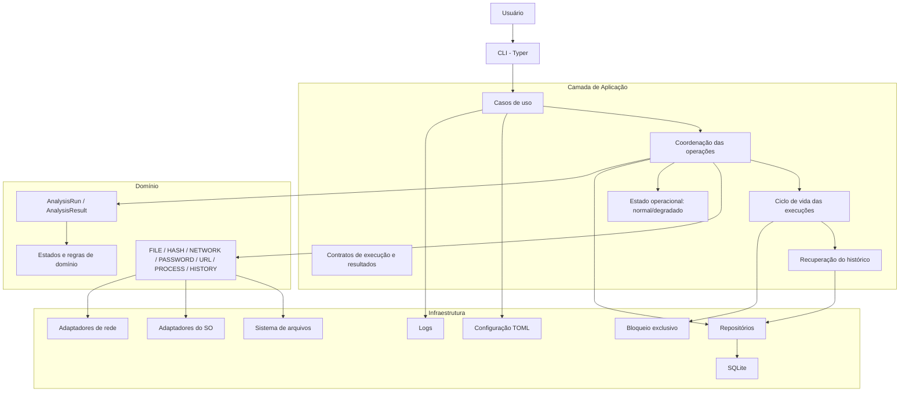
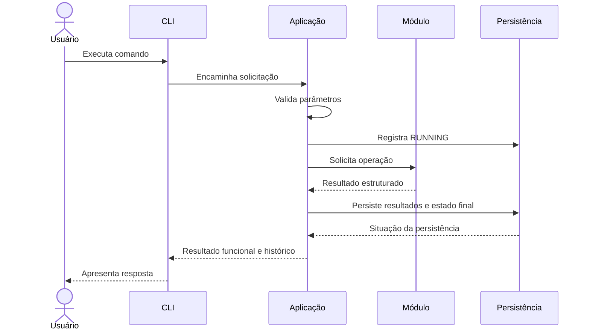

# ARQUITETURA.md

**Projeto:** Odyssey AV  
**Versão:** 2.1  
**Escopo:** MVP  
**Status:** Consolidado para revisão cruzada

---

# 1. Objetivo

Este documento define a arquitetura de software do Odyssey AV, estabelecendo sua organização estrutural, camadas, módulos, responsabilidades, dependências, tecnologias e fluxos de execução.

A arquitetura deverá garantir:

- Separação de responsabilidades.
- Baixo acoplamento entre módulos.
- Facilidade de manutenção e testes.
- Compatibilidade com Windows e Linux.
- Controle das operações de segurança.
- Persistência local dos resultados.
- Recuperação de execuções interrompidas.
- Comportamento previsível diante de falhas de persistência.
- Possibilidade de evolução sem comprometer o MVP.

# 2. Visão geral da arquitetura

O Odyssey AV utilizará uma arquitetura de monólito modular organizada em camadas.

A aplicação será executada localmente, por meio de uma interface de linha de comando (CLI).

Os módulos funcionais compartilharão serviços transversais, como validação, configuração, logs, identificação de instância e persistência.

A lógica de negócio deverá permanecer independente dos detalhes de infraestrutura.

## 2.1. Modelo arquitetural



O diagrama representa a organização lógica. As dependências concretas deverão respeitar os limites definidos neste documento.

O módulo HISTORY deverá consultar e exportar dados por meio dos casos de uso e contratos da aplicação, sem acessar diretamente o SQLite.

# 3. Estilo arquitetural

## 3.1. Monólito modular

O Odyssey AV será desenvolvido como uma única aplicação, organizada internamente em módulos independentes por responsabilidade.

Os módulos compartilharão o mesmo processo de execução e a mesma infraestrutura local, mantendo limites claros de responsabilidade.

### Justificativa

- Escopo reduzido do MVP.
- Execução local.
- Ausência de necessidade de serviços distribuídos.
- Simplicidade de implantação.
- Facilidade de depuração e testes.
- Menor custo de manutenção.

Microsserviços e arquitetura distribuída não serão adotados no MVP por adicionarem complexidade sem necessidade funcional identificada.

# 4. Organização em camadas

## 4.1. Apresentação — CLI

**Tecnologia:** Typer.

Responsabilidades:

- Receber comandos e argumentos.
- Validar a estrutura básica dos parâmetros.
- Encaminhar solicitações aos casos de uso.
- Apresentar resultados.
- Exibir mensagens de erro e avisos.
- Disponibilizar saídas legíveis e automatizáveis.
- Traduzir resultados em códigos de saída.

A CLI não deverá implementar regras de negócio, acessar diretamente o banco, executar operações internas dos módulos ou persistir resultados por conta própria.

## 4.2. Aplicação

Responsável por coordenar os casos de uso e controlar o fluxo das operações.

Responsabilidades:

- Receber solicitações da CLI.
- Acionar os módulos correspondentes.
- Coordenar a execução das operações.
- Gerenciar o ciclo de vida das execuções.
- Aplicar validações necessárias.
- Organizar resultados.
- Solicitar persistência quando aplicável.
- Tratar falhas durante a execução.
- Separar resultado funcional da situação da persistência.
- Coordenar a identificação da instância ativa.
- Executar a recuperação do histórico na inicialização.
- Determinar se a aplicação está em modo normal ou degradado.

Casos de uso previstos:

| Caso de uso | Responsabilidade |
|---|---|
| AnalyzeFile | Coordenar análise de arquivos |
| CalculateHash | Calcular hash |
| CompareHash | Comparar hashes |
| DiagnoseNetwork | Executar diagnóstico de rede |
| GeneratePassword | Gerar senha |
| EvaluatePassword | Avaliar senha |
| AnalyzeUrl | Analisar URL |
| ListProcesses | Consultar processos |
| ListHistory | Consultar histórico |
| ShowHistory | Consultar detalhes de uma execução |
| ExportHistory | Exportar relatórios |

Os casos de uso representam operações da aplicação, não necessariamente classes obrigatórias.

## 4.3. Domínio

Responsável pelas entidades, estados, regras e estruturas que representam o funcionamento do Odyssey AV.

Elementos principais:

- `AnalysisRun`
- `AnalysisResult`
- `ExecutionStatus`
- `ResultStatus`
- `Module`

Objetos internos:

- `FileMetadata`
- `HashReference`
- `NetworkCheck`
- `PasswordEvaluation`
- `UrlFinding`
- `ProcessSnapshot`
- `SecurityFinding`

Esses objetos não constituem necessariamente entidades persistentes. A definição detalhada está em `MODELO-DE-DADOS.md`.

## 4.4. Infraestrutura

Responsável pela comunicação com recursos externos à lógica principal e pela implementação dos mecanismos técnicos definidos pelos contratos internos.

| Componente | Responsabilidade |
|---|---|
| SQLite Repository | Persistência local |
| Filesystem Adapter | Acesso ao sistema de arquivos |
| OS Adapter | Operações dependentes do sistema operacional |
| Network Adapter | Operações de rede |
| Instance Lock | Bloqueio exclusivo |
| Configuration Provider | Leitura de configurações |
| Logging Provider | Registro operacional |

O acesso ao SQLite deverá ser centralizado na infraestrutura. A aplicação dependerá de contratos, e não de implementações concretas desnecessárias.

# 5. Módulos funcionais

O MVP contempla exatamente sete módulos.

## 5.1. FILE — Análise de arquivos

- Obter metadados.
- Identificar formatos suportados.
- Comparar extensão e assinatura.
- Identificar divergências.
- Produzir resultados estruturados.

Assinaturas iniciais: PE, ELF, PDF, PNG, JPEG, ZIP e GZIP, além da classificação como desconhecido.

O módulo deverá aceitar arquivos regulares, rejeitar tipos de recursos não permitidos e respeitar as restrições de acesso definidas para o MVP.

## 5.2. HASH — Hash

- Calcular SHA-256.
- Comparar hashes.
- Classificar resultados.
- Verificar integridade.

A comparação utilizará uma referência fornecida pelo usuário. Não haverá base própria de hashes no MVP.

## 5.3. NETWORK — Diagnóstico de rede

- Verificar conectividade.
- Realizar consultas DNS.
- Consultar IP público quando solicitado.
- Organizar resultados das verificações.

Operações externas deverão decorrer de solicitação explícita.

## 5.4. PASSWORD — Ferramentas de senha

- Gerar senhas.
- Avaliar características básicas.
- Aplicar parâmetros de geração.
- Impedir persistência dos valores de senha.

Deverá utilizar geração aleatória segura e manter senhas fora do histórico, logs e relatórios.

## 5.5. URL — Análise de URL

- Interpretar URLs.
- Normalizar endereços.
- Identificar indicadores suspeitos.
- Produzir resultados sem acessar automaticamente o destino.

A análise será local, sem requisições HTTP ou consultas DNS implícitas.

## 5.6. PROCESS — Monitoramento de processos

- Listar processos acessíveis.
- Consultar PID e nome.
- Obter métricas disponíveis.
- Aplicar filtros.
- Comunicar limitações de acesso.

Será exclusivamente informativo. Não poderá encerrar, suspender, modificar ou interferir na execução dos processos.

## 5.7. HISTORY — Histórico e relatórios

- Consultar execuções anteriores.
- Consultar resultados.
- Aplicar filtros.
- Exportar JSON e CSV.
- Preservar as regras de privacidade.

Não deverá acessar diretamente o SQLite. Consultas e exportações não gerarão novos registros `AnalysisRun`.

O HISTORY dependerá da disponibilidade do mecanismo de persistência. No modo degradado, suas operações deverão ser recusadas com mensagem clara.

# 6. Serviços transversais

## 6.1. Validação

Validar entradas e parâmetros antes do processamento, respeitando as regras específicas de cada módulo.

## 6.2. Configuração

A configuração será local e poderá utilizar arquivo TOML.

Precedência:

1. Padrões internos.
2. Valores definidos no TOML.
3. Argumentos explicitamente fornecidos na CLI.

A ausência do arquivo será permitida. Arquivos inválidos deverão gerar erro claro.

## 6.3. Logs

Registrar eventos operacionais relevantes.

Os logs não substituirão o histórico e deverão evitar informações sensíveis, especialmente senhas e argumentos secretos.

## 6.4. Identificação de instância

Cada inicialização válida deverá possuir um UUID `instance_id`, utilizado para associar as execuções à instância correspondente.

## 6.5. Ciclo de vida das execuções

Coordenar:

- Início de execução.
- Registro de `RUNNING`.
- Recebimento dos resultados.
- Atualização do estado final.
- Persistência dos resultados.
- Recuperação de execuções interrompidas.
- Tratamento de falhas de persistência.

## 6.6. Estado operacional da aplicação

A aplicação deverá possuir dois estados operacionais:

| Estado | Significado |
|---|---|
| `NORMAL` | Recuperação concluída e persistência disponível |
| `DEGRADED` | Recuperação do histórico falhou; persistência indisponível durante a sessão |

O estado operacional não substitui os estados de execução (`RUNNING`, `SUCCESS`, `PARTIAL`, `FAILED` e `INTERRUPTED`).

O modo degradado deverá ser definido durante a inicialização, quando a recuperação do histórico não puder ser concluída.

# 7. Dependências entre componentes

Regras:

1. A CLI depende da camada de aplicação.
2. A aplicação coordena os módulos funcionais.
3. Os módulos não dependem diretamente da CLI.
4. Os módulos não devem depender uns dos outros sem necessidade funcional.
5. A infraestrutura implementa mecanismos de acesso a recursos externos.
6. A aplicação utiliza contratos para acessar a persistência.
7. A infraestrutura não contém regras de negócio dos módulos.
8. HISTORY recebe dados por meio dos contratos da aplicação.
9. Módulos funcionais não acessam diretamente SQLite.
10. Dependências circulares deverão ser evitadas.

Fluxo permitido:

```text
CLI
 |
 v
Caso de uso
 |
 v
Módulo funcional
 |
 v
Resultado estruturado
 |
 v
Aplicação
 |
 v
Contrato de persistência
 |
 v
SQLite Repository
```

# 8. Fluxo de execução

Uma operação funcional em modo normal deverá seguir o fluxo:



Operações PASSWORD deverão aplicar tratamento específico para impedir que valores de senha sejam enviados à persistência.

## 8.1. Separação entre operação e persistência

O resultado funcional e a persistência do histórico são responsabilidades distintas.

Exemplo:

```text
Operação HASH:
    Cálculo concluído com sucesso.

Persistência:
    Falha ao registrar o resultado no SQLite.

Resposta:
    Resultado funcional: SUCCESS
    Histórico: FAILED
```

A falha de persistência não deverá transformar automaticamente uma operação funcional bem-sucedida em falha funcional.

## 8.2. Ciclo de vida da execução

Estados persistidos:

- `RUNNING`
- `SUCCESS`
- `PARTIAL`
- `FAILED`
- `INTERRUPTED`

O estado `INTERRUPTED` será utilizado quando uma execução permanecer em `RUNNING` após o encerramento inesperado da instância responsável.

# 9. Persistência e banco de dados

**Banco de dados:** SQLite.

O MVP utilizará inicialmente duas entidades persistentes:

- `AnalysisRun`
- `AnalysisResult`

O relacionamento será de um para muitos (1:N).

Diretrizes:

- Consultas parametrizadas.
- Integridade referencial.
- Controle de transações.
- Minimização de dados.
- Não armazenar conteúdo integral de arquivos.
- Não persistir senhas.
- Datas em UTC.
- Acesso centralizado na infraestrutura.

A estrutura detalhada está em `MODELO-DE-DADOS.md`.

## 9.1. Histórico e operações recursivas

Consultas e exportações do HISTORY não deverão gerar registros de execução recursivos.

# 10. Gerenciamento de instância e recuperação

## 10.1. Instância única ativa

O MVP permitirá somente uma instância ativa do Odyssey AV por vez.

O controle utilizará mecanismo de bloqueio exclusivo compatível com Windows e Linux.

O bloqueio deverá ser adquirido antes das operações funcionais. Se outra instância estiver ativa, a nova inicialização deverá ser impedida com mensagem clara.

## 10.2. Identificação da instância

Cada inicialização válida deverá gerar um UUID para `instance_id`.

As execuções daquela inicialização utilizarão o mesmo identificador. O identificador não deverá ser reutilizado.

## 10.3. Recuperação de execuções

Após obter o bloqueio exclusivo, a aplicação deverá consultar execuções anteriores que permaneceram em `RUNNING`.

As execuções pertencentes a instâncias anteriores deverão ser atualizadas para `INTERRUPTED`.

A recuperação não deverá depender exclusivamente do PID, devido à possibilidade de reutilização pelo sistema operacional.

## 10.4. Falha durante a recuperação do histórico

Se o SQLite estiver indisponível ou ocorrer uma falha que impeça a conclusão da recuperação, a aplicação deverá entrar em modo degradado.

O modo degradado deverá respeitar as seguintes regras:

1. A aplicação deverá manter o bloqueio exclusivo durante a sessão.
2. A falha de recuperação deverá ser comunicada ao usuário.
3. As ferramentas funcionais FILE, HASH, NETWORK, PASSWORD, URL e PROCESS poderão continuar disponíveis.
4. Nenhuma nova execução deverá ser apresentada como persistida.
5. A aplicação não deverá tentar realizar gravações parciais no histórico como se a recuperação tivesse sido concluída.
6. O módulo HISTORY deverá ficar indisponível para consultas e exportações.
7. A CLI deverá informar que os resultados da sessão não serão armazenados no histórico.
8. A falha de persistência deverá permanecer separada do resultado funcional das operações.
9. A aplicação não deverá ignorar silenciosamente execuções antigas em `RUNNING`.
10. A recuperação será tentada novamente em uma inicialização posterior.

O modo degradado não deverá ser interpretado como recuperação bem-sucedida. Ele representa uma condição operacional limitada.

A decisão de permitir operações funcionais sem persistência não autoriza a criação de um mecanismo alternativo de armazenamento no MVP.

## 10.5. Liberação do bloqueio

O bloqueio deverá ser liberado no encerramento normal.

Em encerramentos inesperados, o mecanismo do sistema operacional deverá permitir a liberação quando o processo responsável deixar de existir.

# 11. Segurança arquitetural

Diretrizes:

1. Não executar arquivos analisados.
2. Não modificar arquivos durante a análise.
3. Validar entradas antes do processamento.
4. Não utilizar shell com comandos construídos a partir de entradas do usuário.
5. Não persistir senhas.
6. Não realizar requisições automáticas durante análise de URLs.
7. Controlar operações externas de rede.
8. Respeitar permissões do sistema operacional.
9. Utilizar consultas parametrizadas no SQLite.
10. Evitar exposição de informações sensíveis.
11. Não solicitar elevação de privilégios automaticamente.
12. Não seguir links simbólicos automaticamente durante análise de arquivos.
13. Separar resultados funcionais de falhas de persistência.
14. Informar quando a aplicação estiver operando em modo degradado.

Os controles detalhados serão especificados em `SEGURANCA.md`.

# 12. Tratamento de erros

Categorias:

| Categoria | Exemplo |
|---|---|
| Entrada inválida | Caminho ou parâmetro incorreto |
| Acesso negado | Arquivo ou processo sem permissão |
| Recurso indisponível | Serviço DNS ou rede inacessível |
| Falha de processamento | Erro durante análise |
| Falha de persistência | Erro ao registrar histórico |
| Falha de recuperação | Erro ao atualizar execuções antigas |
| Recurso incompatível | Operação não suportada na plataforma |
| Execução interrompida | Processo encerrado antes da conclusão |

Diretrizes:

- Exibir mensagens compreensíveis.
- Preservar informações técnicas necessárias.
- Não revelar segredos.
- Diferenciar falhas funcionais de falhas de persistência.
- Comunicar limitações de acesso.
- Evitar que falhas em um módulo comprometam desnecessariamente os demais.

# 13. Observabilidade

A observabilidade do MVP será local e simples.

Recursos previstos:

- Logs operacionais.
- Identificador da execução.
- Identificador da instância.
- Estado da execução.
- Duração das operações.
- Mensagens de erro sanitizadas.
- Estado operacional da aplicação.

Os logs terão finalidade de diagnóstico técnico. O histórico armazenará os resultados das operações quando disponível.

Logs não substituirão o histórico e não deverão conter senhas ou argumentos secretos.

# 14. Configuração

A aplicação poderá utilizar arquivo TOML opcional.

A precedência será:

1. Padrões internos.
2. Valores do TOML.
3. Argumentos explicitamente fornecidos na CLI.

A ausência do arquivo será permitida. Configurações inválidas deverão produzir mensagens claras.

# 15. Tecnologias

| Componente | Tecnologia | Finalidade |
|---|---|---|
| Linguagem | Python | Desenvolvimento principal |
| CLI | Typer | Interface de linha de comando |
| Persistência | SQLite | Histórico local |
| Acesso ao banco | sqlite3 | Operações de persistência |
| Processos | psutil | Consulta de processos |
| Hash | hashlib | Cálculo SHA-256 |
| Senhas | secrets | Geração segura |
| Testes | pytest | Testes automatizados |
| Configuração | TOML | Configurações locais |
| Controle de versão | Git | Versionamento |
| Repositório | GitHub | Hospedagem |

Bibliotecas padrão deverão ser priorizadas quando atenderem às necessidades do projeto.

# 16. Estratégia de testes

A arquitetura deverá permitir:

- Testes unitários.
- Testes de integração.
- Testes de persistência.
- Testes de segurança.
- Testes de plataforma.
- Testes de recuperação.
- Testes de concorrência.
- Testes de regressão.
- Testes do modo degradado.

A especificação detalhada será mantida em `TESTES.md`.

# 17. Implantação e execução

O Odyssey AV será distribuído inicialmente como aplicação local executada por CLI.

Características:

- Execução local.
- Sem servidor obrigatório.
- Sem banco remoto obrigatório.
- Sem dependência obrigatória de serviços em nuvem.
- Compatibilidade com Windows e Linux suportados.

A forma definitiva de empacotamento será definida durante a implementação.

# 18. Estratégia de evolução

Novos recursos deverão respeitar os contratos existentes, preservar a separação de responsabilidades e evitar dependências circulares.

A evolução deverá preservar a simplicidade do MVP e não antecipar funcionalidades ainda não aprovadas.

A possibilidade de evolução futura para recursos antimalware não justifica implementar mecanismos fora do escopo atual.

# 19. Decisões arquiteturais

| Identificador | Decisão | Justificativa |
|---|---|---|
| ARC-001 | Monólito modular | Simplicidade e separação interna |
| ARC-002 | Arquitetura em camadas | Separação de responsabilidades |
| ARC-003 | CLI com Typer | Interface adequada ao MVP |
| ARC-004 | SQLite local | Persistência sem servidor |
| ARC-005 | Serviços transversais | Reutilização e consistência |
| ARC-006 | Adaptadores de plataforma | Isolamento de diferenças entre SOs |
| ARC-007 | Contratos de execução | Padronização dos resultados |
| ARC-008 | Persistência centralizada | Integridade e controle do histórico |
| ARC-009 | Instância única ativa | Evitar concorrência entre instâncias |
| ARC-010 | UUID por instância | Associar execuções à inicialização |
| ARC-011 | Recuperação de execuções | Evitar registros indefinidamente em RUNNING |
| ARC-012 | Separação entre operação e persistência | Preservar o resultado funcional diante de falha no histórico |
| ARC-013 | Modo degradado após falha de recuperação | Preservar disponibilidade sem declarar o histórico consistente |

Esses identificadores representam decisões documentadas, não arquivos ADR independentes.

# 20. Estado do documento

| Critério | Situação |
|---|---|
| Estilo arquitetural | Definido |
| Camadas | Definidas |
| Módulos | Definidos |
| Responsabilidades | Definidas |
| Dependências | Definidas |
| Fluxo de execução | Definido |
| Ciclo de vida das execuções | Definido |
| Persistência | Definida conceitualmente |
| Instância única | Definida |
| Recuperação de execuções | Definida |
| Modo degradado | Definido |
| Segurança arquitetural | Diretrizes definidas |
| Tratamento de erros | Estruturado |
| Observabilidade | Estruturada |
| Configuração | Estruturada |
| Tecnologias | Definidas preliminarmente |
| Estratégia de testes | Definida conceitualmente |
| Revisão cruzada | Em andamento |

---

**Observação:** este documento especifica a arquitetura do MVP. A implementação física do banco, do bloqueio exclusivo, da recuperação e do modo degradado ocorrerá somente após a consolidação documental e autorização explícita para iniciar o desenvolvimento.