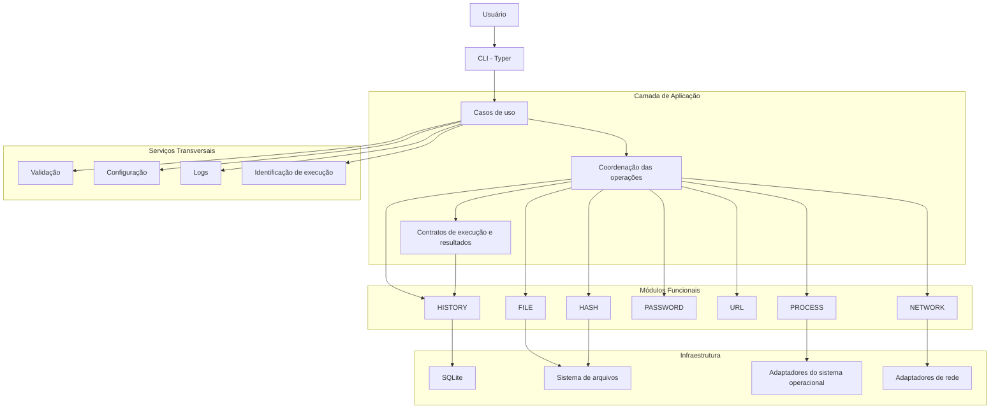
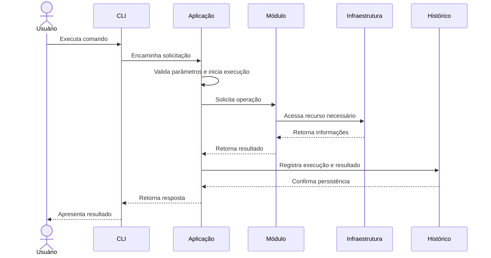

# ARQUITETURA.md

**Projeto:** Odyssey AV  
**Versão:** 1.0  
**Escopo:** MVP  
**Status:** Primeira versão consolidada

---

# 1. Objetivo

Este documento define a arquitetura de software do Odyssey AV, estabelecendo sua organização estrutural, camadas, módulos, responsabilidades, dependências, tecnologias e fluxos de execução.

A arquitetura deverá garantir:

- Separação de responsabilidades.
- Baixo acoplamento entre módulos.
- Facilidade de manutenção e testes.
- Compatibilidade com Windows e Linux.
- Controle das operações de segurança.
- Persistência local dos resultados.
- Possibilidade de evolução sem comprometer o MVP.

---

# 2. Visão geral da arquitetura

O Odyssey AV utilizará uma arquitetura de monólito modular organizada em camadas.

A aplicação será executada localmente, por meio de uma interface de linha de comando (CLI).

Os módulos funcionais compartilharão serviços transversais, como validação, configuração, logs e persistência.

## 2.1. Modelo arquitetural



O diagrama representa a organização lógica da aplicação. As dependências concretas entre componentes deverão respeitar os limites definidos neste documento.

---

# 3. Estilo arquitetural

## 3.1. Monólito modular

O Odyssey AV será desenvolvido como uma única aplicação, organizada internamente em módulos independentes por responsabilidade.

Os módulos compartilharão o mesmo processo de execução e a mesma infraestrutura local, mas deverão manter limites claros de responsabilidade.

### Justificativa

A escolha de um monólito modular considera:

- O escopo reduzido do MVP.
- A execução local da ferramenta.
- A ausência de necessidade de serviços distribuídos.
- A simplicidade de implantação.
- A facilidade de depuração e testes.
- O baixo custo de manutenção.

### Alternativas descartadas

| Alternativa | Motivo |
|---|---|
| Microsserviços | Complexidade desnecessária para uma aplicação local |
| Arquitetura distribuída | Não existe necessidade de comunicação entre serviços independentes |
| Aplicação monolítica sem módulos | Dificultaria a manutenção e aumentaria o acoplamento |

---

# 4. Organização em camadas

A arquitetura será dividida em quatro áreas principais.

## 4.1. Camada de apresentação — CLI

Responsável pela interação entre o usuário e o sistema.

**Tecnologia:** Typer.

### Responsabilidades

- Receber comandos e argumentos.
- Validar a estrutura básica dos parâmetros.
- Encaminhar solicitações aos casos de uso.
- Apresentar resultados.
- Exibir mensagens de erro e avisos.
- Disponibilizar formatos de saída legíveis e automatizáveis.

### Restrições

A CLI não deverá:

- Implementar regras de negócio.
- Acessar diretamente o banco de dados.
- Executar operações internas dos módulos.
- Concentrar lógica de análise.
- Controlar diretamente detalhes de infraestrutura.

---

## 4.2. Camada de aplicação

Responsável por coordenar os casos de uso e controlar o fluxo das operações.

### Responsabilidades

- Receber solicitações da CLI.
- Acionar os módulos correspondentes.
- Coordenar a execução das operações.
- Gerenciar o ciclo de vida de uma execução.
- Aplicar validações necessárias.
- Organizar os resultados.
- Solicitar a persistência quando aplicável.
- Tratar falhas durante a execução.

### Casos de uso previstos

| Caso de uso | Responsabilidade |
|---|---|
| AnalyzeFile | Coordenar análise de arquivos |
| CalculateHash | Calcular hash |
| CompareHash | Comparar hashes |
| DiagnoseNetwork | Executar diagnóstico de rede |
| GeneratePassword | Gerar senha |
| EvaluatePassword | Avaliar senha |
| AnalyzeUrl | Analisar URL |
| ListProcesses | Consultar processos |
| ListHistory | Consultar histórico |
| ExportHistory | Exportar relatórios |

Os casos de uso representam operações da aplicação, não necessariamente classes obrigatórias.

---

## 4.3. Camada de domínio e módulos funcionais

Responsável pelas operações específicas de cada ferramenta.

Cada módulo deverá possuir responsabilidades próprias e não deverá depender diretamente da implementação interna de outro módulo.

### FILE — Análise de arquivos

Responsabilidades:

- Obter metadados.
- Identificar formatos suportados.
- Comparar extensão e assinatura.
- Identificar divergências.
- Produzir resultados estruturados.

### HASH — Hash

Responsabilidades:

- Calcular SHA-256.
- Comparar hashes.
- Classificar resultados.
- Verificar integridade.

### NETWORK — Diagnóstico de rede

Responsabilidades:

- Verificar conectividade.
- Realizar consultas DNS.
- Consultar IP público quando solicitado.
- Organizar resultados das verificações.

### PASSWORD — Ferramentas de senha

Responsabilidades:

- Gerar senhas.
- Avaliar características básicas.
- Aplicar parâmetros de geração.
- Impedir a persistência dos valores de senha.

### URL — Análise de URL

Responsabilidades:

- Interpretar URLs.
- Normalizar endereços.
- Identificar indicadores suspeitos.
- Produzir resultados sem acessar automaticamente o destino.

### PROCESS — Monitoramento de processos

Responsabilidades:

- Listar processos acessíveis.
- Consultar PID e nome.
- Obter métricas disponíveis.
- Aplicar filtros.
- Comunicar limitações de acesso.

### HISTORY — Histórico e relatórios

Responsabilidades:

- Consultar execuções anteriores.
- Consultar resultados.
- Aplicar filtros.
- Exportar JSON e CSV.
- Preservar as regras de privacidade.

---

## 4.4. Camada de infraestrutura

Responsável pela comunicação com recursos externos à lógica principal da aplicação.

### Componentes previstos

| Componente | Responsabilidade |
|---|---|
| SQLite | Persistência local |
| Filesystem | Acesso ao sistema de arquivos |
| OS Adapter | Operações dependentes do sistema operacional |
| Network Adapter | Operações de rede |
| Configuration | Leitura de configurações |
| Logging | Registro operacional |

### Diretrizes

- A infraestrutura não deverá determinar regras de negócio.
- Os módulos não deverão depender diretamente de detalhes desnecessários do banco.
- Operações dependentes do sistema operacional deverão ser isoladas.
- O acesso ao SQLite deverá ser centralizado na infraestrutura de persistência.

---

# 5. Serviços transversais

Os serviços transversais serão compartilhados pelos módulos quando necessário.

## 5.1. Validação

Responsável por validar entradas e parâmetros antes da execução das operações.

Exemplos:

- Caminhos de arquivos.
- Parâmetros de geração de senhas.
- URLs.
- Filtros de processos.
- Parâmetros de consultas de rede.

## 5.2. Configuração

Responsável por centralizar configurações do sistema.

A configuração deverá ser local e poderá utilizar arquivo TOML.

Não deverá armazenar senhas ou segredos desnecessários.

## 5.3. Logs

Responsável por registrar eventos operacionais relevantes.

Os logs não substituirão o histórico de execuções.

Deverão evitar informações sensíveis, especialmente senhas e argumentos secretos.

## 5.4. Identificação de execução

Responsável por fornecer identificadores únicos às operações que serão registradas no histórico.

O identificador deverá permitir relacionar a execução aos resultados correspondentes.

---

# 6. Dependências entre módulos

A arquitetura deverá impedir dependências circulares e acoplamento desnecessário.

### Regras de dependência

1. A CLI depende da camada de aplicação.
2. A aplicação coordena os módulos funcionais.
3. Os módulos não dependem diretamente da CLI.
4. Os módulos não devem depender uns dos outros sem necessidade funcional.
5. A infraestrutura implementa os mecanismos de acesso a recursos externos.
6. A aplicação não deverá conhecer detalhes internos desnecessários da infraestrutura.
7. O histórico deverá receber os dados de execução por meio de contratos definidos pela aplicação.

### Exemplo de fluxo permitido

```text
CLI
 |
 v
Caso de uso
 |
 v
Módulo HASH
 |
 v
Resultado estruturado
 |
 v
Aplicação
 |
 v
Persistência do histórico
```

### Exemplo de dependência não permitida

```text
Módulo FILE
    |
    v
Módulo NETWORK
    |
    v
Módulo HASH
    |
    v
Módulo FILE
```

Esse tipo de dependência circular comprometeria a manutenção e a independência dos módulos.

---

# 7. Fluxo de execução

Uma operação padrão deverá seguir o fluxo abaixo:



O fluxo representa o comportamento geral. Operações como geração e avaliação de senhas deverão aplicar tratamento específico para impedir que os valores sensíveis sejam registrados.

## 7.1. Ciclo de vida da execução

As execuções persistidas deverão seguir os estados definidos no modelo de domínio:

- RUNNING
- SUCCESS
- PARTIAL
- FAILED

O registro deverá ser iniciado quando uma operação elegível começar.

Ao término, a aplicação deverá atualizar o estado e registrar os resultados disponíveis.

Em caso de falha, deverá preservar as informações que puderem ser registradas com segurança.

A recuperação de execuções interrompidas inesperadamente deverá ser tratada pelo mecanismo de persistência.

---

# 8. Persistência e banco de dados

## 8.1. Tecnologia

**Banco de dados:** SQLite.

O SQLite foi escolhido por oferecer persistência local sem exigir servidor de banco de dados.

### Responsabilidades

- Armazenar execuções.
- Armazenar resultados.
- Permitir consultas ao histórico.
- Manter relacionamentos entre execuções e resultados.

## 8.2. Estrutura persistente

O MVP utilizará inicialmente duas entidades:

- `AnalysisRun`
- `AnalysisResult`

O relacionamento será de um para muitos (1:N).

A estrutura detalhada está documentada em `MODELO-DE-DADOS.md`.

## 8.3. Diretrizes de persistência

- Utilizar consultas parametrizadas.
- Garantir integridade referencial.
- Controlar transações.
- Evitar persistência de informações sensíveis.
- Não armazenar conteúdo integral dos arquivos.
- Não persistir senhas.
- Evitar registros duplicados por falhas de fluxo.

## 8.4. Histórico e operações recursivas

A consulta e a exportação do histórico não deverão gerar registros de execução recursivos.

A execução do módulo HISTORY deverá ser tratada de maneira específica para evitar que consultar o histórico altere continuamente o próprio histórico.

---

# 9. Segurança arquitetural

A segurança será tratada como uma preocupação transversal.

Os mecanismos de proteção deverão ser aplicados nas camadas responsáveis por cada operação.

### Diretrizes

1. Não executar arquivos analisados.
2. Não modificar arquivos durante a análise.
3. Validar entradas antes do processamento.
4. Não utilizar shell para executar comandos construídos a partir de entradas do usuário.
5. Não persistir senhas.
6. Não realizar requisições automáticas durante a análise de URLs.
7. Controlar e identificar operações externas de rede.
8. Respeitar as permissões do sistema operacional.
9. Utilizar consultas parametrizadas no SQLite.
10. Evitar exposição de informações sensíveis em logs e relatórios.
11. Não solicitar elevação de privilégios automaticamente.

Os controles detalhados serão especificados em `SEGURANCA.md`.

---

# 10. Tratamento de erros

O tratamento de erros deverá ser consistente entre os módulos.

### Categorias de falhas

| Categoria | Exemplo |
|---|---|
| Entrada inválida | Caminho ou parâmetro incorreto |
| Acesso negado | Arquivo ou processo sem permissão |
| Recurso indisponível | Serviço DNS ou rede inacessível |
| Falha de processamento | Erro durante análise |
| Falha de persistência | Erro ao registrar histórico |
| Recurso incompatível | Operação não suportada na plataforma |

### Diretrizes

- Exibir mensagens compreensíveis.
- Preservar informações técnicas necessárias para diagnóstico.
- Não revelar segredos.
- Diferenciar falhas de execução de resultados negativos de análise.
- Evitar que uma falha em um módulo comprometa os demais.

---

# 11. Observabilidade

A observabilidade do MVP será simples e local.

### Recursos previstos

- Logs operacionais.
- Identificador de execução.
- Estado da execução.
- Duração das operações.
- Mensagens de erro.
- Histórico de resultados.

Não será necessária uma plataforma externa de monitoramento.

Os logs terão finalidade de diagnóstico técnico, enquanto o histórico armazenará os resultados das operações disponíveis para consulta.

---

# 12. Configuração

A aplicação deverá permitir configurações locais.

A proposta inicial é utilizar um arquivo TOML.

### Exemplos de configurações

- Preferências gerais de execução.
- Configurações de saída.
- Localização dos dados persistidos.
- Parâmetros operacionais dos módulos, quando aplicável.

### Diretrizes

- Valores padrão deverão permitir a execução básica.
- Configurações inválidas deverão produzir mensagens claras.
- Dados sensíveis não deverão ser armazenados em texto simples.
- A aplicação deverá funcionar sem configuração avançada obrigatória.

---

# 13. Tecnologias

| Componente | Tecnologia | Finalidade |
|---|---|---|
| Linguagem | Python | Desenvolvimento principal |
| CLI | Typer | Interface de linha de comando |
| Persistência | SQLite | Histórico local |
| Acesso ao banco | sqlite3 | Operações de persistência |
| Processos | psutil | Consulta de processos |
| Hash | hashlib | Cálculo SHA-256 |
| Senhas | secrets | Geração segura |
| Testes | pytest | Testes automatizados |
| Configuração | TOML | Configurações locais |
| Controle de versão | Git | Versionamento do código |
| Repositório | GitHub | Hospedagem do projeto |

As bibliotecas padrão do Python deverão ser priorizadas quando atenderem às necessidades do projeto.

---

# 14. Estratégia de testes

A arquitetura deverá permitir testes isolados dos módulos e testes integrados dos fluxos de execução.

### Tipos de testes

| Tipo | Objetivo |
|---|---|
| Unitários | Validar funções e regras isoladamente |
| Integração | Validar comunicação entre camadas |
| Persistência | Verificar operações SQLite |
| Segurança | Verificar proteção de entradas e dados sensíveis |
| Plataforma | Validar Windows e Linux |
| Regressão | Evitar que alterações quebrem funcionalidades existentes |

A especificação detalhada será mantida em `TESTES.md`.

---

# 15. Implantação e execução

O Odyssey AV será distribuído inicialmente como uma aplicação local executada por linha de comando.

### Características

- Execução local.
- Sem servidor obrigatório.
- Sem banco de dados remoto obrigatório.
- Sem dependência de serviços em nuvem para as operações locais.
- Compatibilidade com Windows e Linux suportados.

A forma definitiva de empacotamento e distribuição deverá ser definida durante a implementação.

---

# 16. Estratégia de evolução

A arquitetura deverá permitir que novos recursos sejam incorporados sem comprometer os módulos existentes.

Para isso:

- Novos módulos deverão respeitar os contratos de execução.
- A CLI deverá permanecer separada da lógica funcional.
- A persistência deverá ser acessada por uma camada própria.
- Serviços transversais deverão evitar duplicação de lógica.
- Dependências circulares deverão ser evitadas.
- Alterações arquiteturais relevantes deverão ser documentadas.

A evolução deverá preservar a simplicidade do MVP e não antecipar funcionalidades que ainda não fazem parte do escopo aprovado.

---

# 17. Decisões arquiteturais

| Identificador | Decisão | Justificativa |
|---|---|---|
| ARC-001 | Monólito modular | Simplicidade e separação interna |
| ARC-002 | Arquitetura em camadas | Separação de responsabilidades |
| ARC-003 | CLI com Typer | Interface adequada ao MVP |
| ARC-004 | SQLite local | Persistência sem servidor |
| ARC-005 | Serviços transversais | Reutilização e consistência |
| ARC-006 | Adaptadores de plataforma | Isolamento de diferenças entre SOs |
| ARC-007 | Contratos de execução | Padronização dos resultados |
| ARC-008 | Persistência centralizada | Integridade e controle do histórico |

Esses identificadores representam decisões documentadas, não arquivos ADR independentes.

---

# 18. Estado do documento

| Critério | Situação |
|---|---|
| Estilo arquitetural | Definido |
| Camadas | Definidas |
| Módulos | Definidos |
| Responsabilidades | Definidas |
| Dependências | Definidas |
| Fluxo de execução | Definido |
| Persistência | Definida conceitualmente |
| Segurança arquitetural | Diretrizes definidas |
| Tratamento de erros | Estruturado |
| Observabilidade | Estruturada |
| Configuração | Estruturada |
| Tecnologias | Definidas preliminarmente |
| Estratégia de testes | Definida conceitualmente |
| Revisão de consistência | Pendente |

