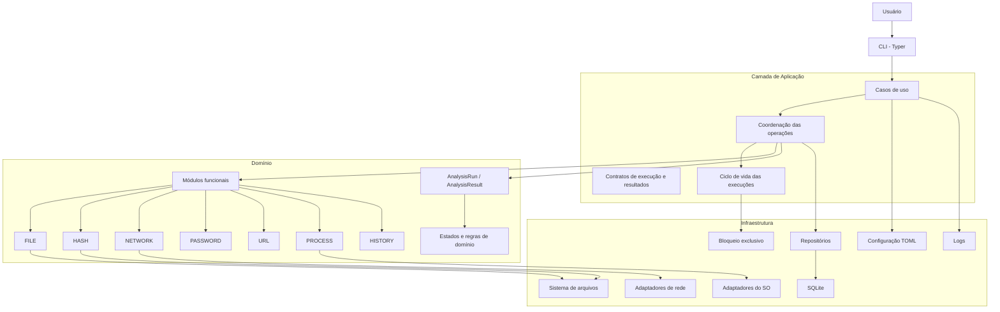
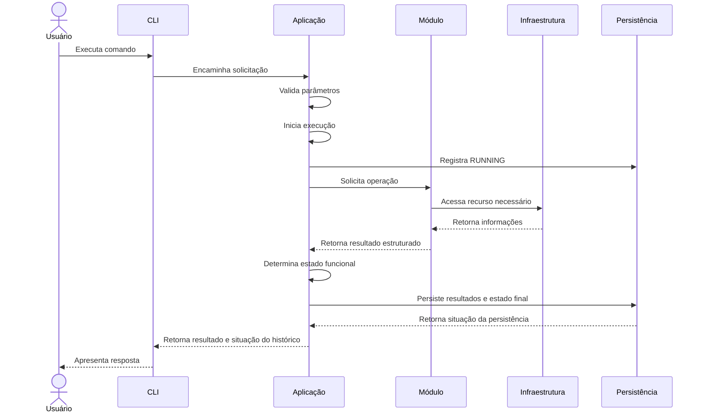
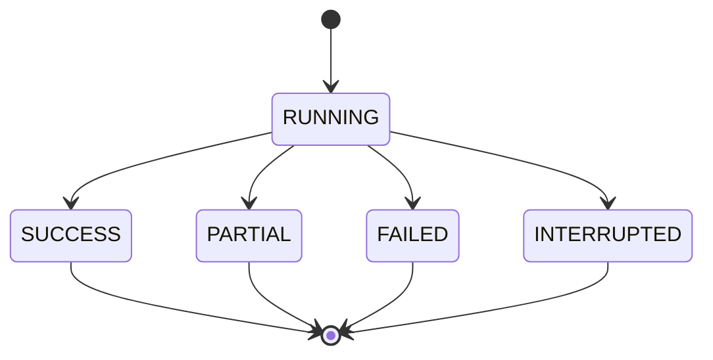

# ARQUITETURA.md

**Projeto:** Odyssey AV  
**Versão:** 2.0  
**Escopo:** MVP  
**Status:** Consolidado para revisão

---

# 1. Objetivo

Este documento define a arquitetura de software do Odyssey AV, estabelecendo sua organização estrutural, camadas, módulos, responsabilidades, dependências, tecnologias e fluxos de execução.

A arquitetura deverá garantir:

- Separação de responsabilidades.
- Baixo acoplamento entre módulos.
- Facilidade de manutenção e testes.
- Compatibilidade com Windows e Linux.
- Controle das operações de segurança.
- Persistência local dos resultados.
- Recuperação de execuções interrompidas.
- Possibilidade de evolução sem comprometer o MVP.

# 2. Visão geral da arquitetura

O Odyssey AV utilizará uma arquitetura de monólito modular organizada em camadas.

A aplicação será executada localmente, por meio de uma interface de linha de comando (CLI).

Os módulos funcionais compartilharão serviços transversais, como validação, configuração, logs, identificação de instância e persistência.

A arquitetura deverá manter a lógica de negócio independente dos detalhes de infraestrutura, permitindo testar os módulos sem depender diretamente do sistema operacional ou do banco de dados.

## 2.1. Modelo arquitetural



O diagrama representa a organização lógica da aplicação. As dependências concretas deverão respeitar os limites definidos neste documento.

O módulo HISTORY deverá consultar e exportar dados por meio dos casos de uso e dos contratos de persistência, sem acessar diretamente o SQLite.

# 3. Estilo arquitetural

## 3.1. Monólito modular

O Odyssey AV será desenvolvido como uma única aplicação, organizada internamente em módulos independentes por responsabilidade.

Os módulos compartilharão o mesmo processo de execução e a mesma infraestrutura local, mas deverão manter limites claros de responsabilidade.

### Justificativa

A escolha de um monólito modular considera:

- O escopo reduzido do MVP.
- A execução local da ferramenta.
- A ausência de necessidade de serviços distribuídos.
- A simplicidade de implantação.
- A facilidade de depuração e testes.
- O baixo custo de manutenção.

### Alternativas descartadas

| Alternativa | Motivo |
|---|---|
| Microsserviços | Complexidade desnecessária para uma aplicação local |
| Arquitetura distribuída | Não existe necessidade de comunicação entre serviços independentes |
| Monólito sem módulos | Dificultaria a manutenção e aumentaria o acoplamento |

# 4. Organização em camadas

A arquitetura será organizada em quatro camadas principais.

## 4.1. Camada de apresentação — CLI

Responsável pela interação entre o usuário e o sistema.

**Tecnologia:** Typer.

### Responsabilidades

- Receber comandos e argumentos.
- Validar a estrutura básica dos parâmetros.
- Encaminhar solicitações aos casos de uso.
- Apresentar resultados.
- Exibir mensagens de erro e avisos.
- Disponibilizar formatos de saída legíveis e automatizáveis.
- Traduzir os resultados da aplicação em códigos de saída da CLI.

### Restrições

A CLI não deverá:

- Implementar regras de negócio.
- Acessar diretamente o banco de dados.
- Executar operações internas dos módulos.
- Concentrar lógica de análise.
- Controlar diretamente detalhes de infraestrutura.
- Persistir resultados por conta própria.

## 4.2. Camada de aplicação

Responsável por coordenar os casos de uso e controlar o fluxo das operações.

### Responsabilidades

- Receber solicitações da CLI.
- Acionar os módulos correspondentes.
- Coordenar a execução das operações.
- Gerenciar o ciclo de vida de uma execução.
- Aplicar validações necessárias.
- Organizar os resultados.
- Solicitar a persistência quando aplicável.
- Tratar falhas durante a execução.
- Separar o resultado funcional da situação da persistência.
- Coordenar a identificação da instância ativa.

### Casos de uso previstos

| Caso de uso | Responsabilidade |
|---|---|
| AnalyzeFile | Coordenar análise de arquivos |
| CalculateHash | Calcular hash |
| CompareHash | Comparar hashes |
| DiagnoseNetwork | Executar diagnóstico de rede |
| GeneratePassword | Gerar senha |
| EvaluatePassword | Avaliar senha |
| AnalyzeUrl | Analisar URL |
| ListProcesses | Consultar processos |
| ListHistory | Consultar histórico |
| ShowHistory | Consultar detalhes de uma execução |
| ExportHistory | Exportar relatórios |

Os casos de uso representam operações da aplicação, não necessariamente classes obrigatórias.

A aplicação deverá coordenar a persistência sem transferir essa responsabilidade diretamente aos módulos funcionais.

## 4.3. Camada de domínio

Responsável pelas entidades, estados, regras e contratos que representam o funcionamento do Odyssey AV.

### Elementos principais

- `AnalysisRun`
- `AnalysisResult`
- `ExecutionStatus`
- `ResultStatus`
- `Module`

### Responsabilidades

- Representar as execuções e seus resultados.
- Definir os estados válidos.
- Preservar as regras de relacionamento entre entidades.
- Definir estruturas de dados independentes de infraestrutura.
- Garantir consistência das regras de domínio.

### Objetos internos

Os objetos abaixo poderão representar informações específicas das operações, sem necessariamente constituir entidades persistentes:

- `FileMetadata`
- `HashReference`
- `NetworkCheck`
- `PasswordEvaluation`
- `UrlFinding`
- `ProcessSnapshot`
- `SecurityFinding`

A definição detalhada das entidades e dos objetos está em `MODELO-DE-DADOS.md`.

## 4.4. Camada de infraestrutura

Responsável pela comunicação com recursos externos à lógica principal da aplicação e pela implementação dos mecanismos técnicos definidos pelos contratos internos.

### Componentes previstos

| Componente | Responsabilidade |
|---|---|
| SQLite Repository | Persistência local |
| Filesystem Adapter | Acesso ao sistema de arquivos |
| OS Adapter | Operações dependentes do sistema operacional |
| Network Adapter | Operações de rede |
| Instance Lock | Bloqueio exclusivo da aplicação |
| Configuration Provider | Leitura de configurações |
| Logging Provider | Registro operacional |

### Diretrizes

- A infraestrutura não deverá determinar regras de negócio.
- Os módulos não deverão depender diretamente de detalhes do banco.
- Operações dependentes do sistema operacional deverão ser isoladas.
- O acesso ao SQLite deverá ser centralizado na infraestrutura de persistência.
- A aplicação deverá depender de contratos, não de implementações concretas desnecessárias.

# 5. Módulos funcionais

Cada módulo deverá possuir responsabilidades próprias e produzir resultados estruturados.

Os módulos não deverão acessar diretamente o banco de dados SQLite.

## 5.1. FILE — Análise de arquivos

Responsabilidades:

- Obter metadados.
- Identificar formatos suportados.
- Comparar extensão e assinatura.
- Identificar divergências.
- Produzir resultados estruturados.

Formatos iniciais:

- PE.
- ELF.
- PDF.
- PNG.
- JPEG.
- ZIP.
- GZIP.
- Desconhecido.

O módulo deverá aceitar arquivos regulares, rejeitar tipos de recursos não permitidos e respeitar as restrições de acesso definidas para o MVP.

## 5.2. HASH — Hash

Responsabilidades:

- Calcular SHA-256.
- Comparar hashes.
- Classificar resultados.
- Verificar integridade.

A comparação deverá utilizar uma referência fornecida pelo usuário. O módulo não deverá depender de uma base própria de hashes.

## 5.3. NETWORK — Diagnóstico de rede

Responsabilidades:

- Verificar conectividade.
- Realizar consultas DNS.
- Consultar IP público quando solicitado.
- Organizar resultados das verificações.

As operações externas deverão ocorrer somente mediante solicitação explícita.

## 5.4. PASSWORD — Ferramentas de senha

Responsabilidades:

- Gerar senhas.
- Avaliar características básicas.
- Aplicar parâmetros de geração.
- Impedir a persistência dos valores de senha.

O módulo deverá utilizar mecanismos de geração aleatória segura e manter os valores de senha fora do histórico, logs e relatórios.

## 5.5. URL — Análise de URL

Responsabilidades:

- Interpretar URLs.
- Normalizar endereços.
- Identificar indicadores suspeitos.
- Produzir resultados sem acessar automaticamente o destino.

A análise deverá ser local e não deverá realizar requisições HTTP ou consultas DNS implícitas.

## 5.6. PROCESS — Monitoramento de processos

Responsabilidades:

- Listar processos acessíveis.
- Consultar PID e nome.
- Obter métricas disponíveis.
- Aplicar filtros.
- Comunicar limitações de acesso.

O módulo será exclusivamente informativo. Não poderá encerrar, suspender, modificar ou interferir na execução dos processos.

## 5.7. HISTORY — Histórico e relatórios

Responsabilidades:

- Consultar execuções anteriores.
- Consultar resultados.
- Aplicar filtros.
- Exportar JSON e CSV.
- Preservar as regras de privacidade.

O módulo não deverá acessar diretamente o SQLite. A consulta e a exportação deverão utilizar os contratos disponibilizados pela camada de aplicação.

Consultas e exportações não deverão gerar novos registros `AnalysisRun`.

# 6. Serviços transversais

Os serviços transversais serão compartilhados pela aplicação quando necessário.

## 6.1. Validação

Responsável por validar entradas e parâmetros antes da execução das operações.

Exemplos:

- Caminhos de arquivos.
- Parâmetros de geração de senhas.
- URLs.
- Filtros de processos.
- Parâmetros de consultas de rede.

A validação deverá respeitar as regras específicas de cada módulo.

## 6.2. Configuração

Responsável por centralizar configurações do sistema.

A configuração deverá ser local e poderá utilizar arquivo TOML.

A precedência será:

1. Padrões internos.
2. Valores definidos no arquivo TOML.
3. Argumentos explicitamente fornecidos na CLI.

A ausência do arquivo deverá ser permitida. Arquivos inválidos deverão gerar erro claro.

## 6.3. Logs

Responsável por registrar eventos operacionais relevantes.

Os logs não substituirão o histórico de execuções.

Deverão evitar informações sensíveis, especialmente senhas e argumentos secretos.

## 6.4. Identificação de instância

Responsável por identificar uma inicialização válida da aplicação.

Cada instância deverá possuir um `instance_id` único, utilizado para associar as execuções à inicialização correspondente.

## 6.5. Ciclo de vida das execuções

Responsável por coordenar:

- Início de uma execução.
- Registro do estado `RUNNING`.
- Recebimento dos resultados.
- Atualização do estado final.
- Persistência dos resultados.
- Recuperação de execuções interrompidas.

Esse serviço deverá manter separação entre o resultado funcional e a situação da persistência.

# 7. Dependências entre componentes

A arquitetura deverá impedir dependências circulares e acoplamento desnecessário.

### Regras de dependência

1. A CLI depende da camada de aplicação.
2. A aplicação coordena os módulos funcionais.
3. Os módulos não dependem diretamente da CLI.
4. Os módulos não devem depender uns dos outros sem necessidade funcional.
5. A infraestrutura implementa os mecanismos de acesso a recursos externos.
6. A aplicação deverá utilizar contratos para acessar a persistência.
7. A infraestrutura não deverá conter regras de negócio dos módulos.
8. O histórico deverá receber dados por meio dos contratos definidos pela aplicação.
9. Os módulos funcionais não deverão acessar diretamente SQLite.
10. Dependências circulares deverão ser evitadas.

### Exemplo de fluxo permitido

```text
CLI
 |
 v
Caso de uso
 |
 v
Módulo HASH
 |
 v
Resultado estruturado
 |
 v
Aplicação
 |
 v
Contrato de persistência
 |
 v
SQLite Repository
```

### Exemplo de dependência não permitida

```text
Módulo FILE
    |
    v
Módulo NETWORK
    |
    v
Módulo HASH
    |
    v
Módulo FILE
```

Esse tipo de dependência circular comprometeria a manutenção e a independência dos módulos.

# 8. Fluxo de execução

Uma operação funcional padrão deverá seguir o fluxo abaixo:



O fluxo representa o comportamento geral. Operações PASSWORD deverão aplicar tratamento específico para impedir que valores de senha sejam enviados à persistência.

## 8.1. Separação entre operação e persistência

A operação funcional e a persistência do histórico são responsabilidades distintas.

Exemplo:

```text
Operação HASH:
    Cálculo concluído com sucesso.

Persistência:
    Falha ao registrar o resultado no SQLite.

Resposta:
    Resultado funcional: SUCCESS
    Histórico: FAILED
```

A falha de persistência não deverá transformar automaticamente uma operação funcional bem-sucedida em falha funcional.

A CLI deverá comunicar ambas as situações, utilizando os códigos de saída definidos em `API.md`.

## 8.2. Ciclo de vida da execução

As execuções persistidas deverão utilizar os seguintes estados:

- `RUNNING`
- `SUCCESS`
- `PARTIAL`
- `FAILED`
- `INTERRUPTED`

Fluxo conceitual:



O registro deverá ser iniciado quando uma operação elegível começar.

Ao término, a aplicação deverá atualizar o estado e registrar os resultados disponíveis.

Em caso de falha, deverá preservar as informações que puderem ser registradas com segurança.

O estado `INTERRUPTED` será utilizado quando uma execução permanecer em `RUNNING` após o encerramento inesperado da instância responsável.

# 9. Persistência e banco de dados

## 9.1. Tecnologia

**Banco de dados:** SQLite.

O SQLite foi escolhido por oferecer persistência local sem exigir servidor de banco de dados.

### Responsabilidades

- Armazenar execuções.
- Armazenar resultados.
- Permitir consultas ao histórico.
- Manter relacionamentos entre execuções e resultados.
- Preservar integridade referencial.

## 9.2. Estrutura persistente

O MVP utilizará inicialmente duas entidades:

- `AnalysisRun`
- `AnalysisResult`

O relacionamento será de um para muitos (1:N).

Cada execução deverá possuir um `instance_id` que identifique a instância responsável por sua criação.

A estrutura detalhada está documentada em `MODELO-DE-DADOS.md`.

## 9.3. Diretrizes de persistência

- Utilizar consultas parametrizadas.
- Garantir integridade referencial.
- Controlar transações.
- Evitar persistência de informações sensíveis.
- Não armazenar conteúdo integral dos arquivos.
- Não persistir senhas.
- Evitar registros duplicados por falhas de fluxo.
- Utilizar datas em UTC.
- Centralizar o acesso ao banco na infraestrutura.

## 9.4. Histórico e operações recursivas

A consulta e a exportação do histórico não deverão gerar registros de execução recursivos.

A execução do módulo HISTORY deverá ser tratada de maneira específica para evitar que consultar o histórico altere continuamente o próprio histórico.

# 10. Gerenciamento de instância e recuperação

## 10.1. Instância única ativa

O MVP deverá permitir somente uma instância ativa do Odyssey AV por vez.

O controle deverá utilizar um mecanismo de bloqueio exclusivo compatível com Windows e Linux.

O bloqueio deverá ser adquirido antes de iniciar operações funcionais.

Se outra instância já estiver ativa, a nova inicialização deverá ser impedida ou encerrada com mensagem clara.

## 10.2. Identificação da instância

Cada inicialização válida deverá gerar um UUID para `instance_id`.

As execuções registradas durante aquela inicialização deverão utilizar o mesmo identificador.

O identificador não deverá ser reutilizado em inicializações posteriores.

## 10.3. Recuperação de execuções

Após obter o bloqueio exclusivo, a aplicação deverá consultar execuções anteriores que permaneceram no estado `RUNNING`.

As execuções pertencentes a instâncias anteriores deverão ser atualizadas para `INTERRUPTED`.

A recuperação não deverá depender exclusivamente do PID, pois o sistema operacional pode reutilizar identificadores de processos.

## 10.4. Liberação do bloqueio

O bloqueio deverá ser liberado no encerramento normal da aplicação.

Em encerramentos inesperados, o mecanismo do sistema operacional deverá permitir a liberação do bloqueio quando o processo responsável deixar de existir.

O bloqueio não deverá ser confundido com um registro persistente de estado da aplicação.

# 11. Segurança arquitetural

A segurança será tratada como uma preocupação transversal.

Os mecanismos de proteção deverão ser aplicados nas camadas responsáveis por cada operação.

### Diretrizes

1. Não executar arquivos analisados.
2. Não modificar arquivos durante a análise.
3. Validar entradas antes do processamento.
4. Não utilizar shell para executar comandos construídos a partir de entradas do usuário.
5. Não persistir senhas.
6. Não realizar requisições automáticas durante a análise de URLs.
7. Controlar e identificar operações externas de rede.
8. Respeitar as permissões do sistema operacional.
9. Utilizar consultas parametrizadas no SQLite.
10. Evitar exposição de informações sensíveis em logs e relatórios.
11. Não solicitar elevação de privilégios automaticamente.
12. Não seguir links simbólicos automaticamente durante a análise de arquivos.
13. Separar resultados funcionais de falhas de persistência.

Os controles detalhados serão especificados em `SEGURANCA.md`.

# 12. Tratamento de erros

O tratamento de erros deverá ser consistente entre os módulos.

### Categorias de falhas

| Categoria | Exemplo |
|---|---|
| Entrada inválida | Caminho ou parâmetro incorreto |
| Acesso negado | Arquivo ou processo sem permissão |
| Recurso indisponível | Serviço DNS ou rede inacessível |
| Falha de processamento | Erro durante análise |
| Falha de persistência | Erro ao registrar histórico |
| Recurso incompatível | Operação não suportada na plataforma |
| Execução interrompida | Processo encerrado antes da conclusão |

### Diretrizes

- Exibir mensagens compreensíveis.
- Preservar informações técnicas necessárias para diagnóstico.
- Não revelar segredos.
- Diferenciar falhas de execução de resultados negativos de análise.
- Diferenciar falhas funcionais de falhas de persistência.
- Evitar que uma falha em um módulo comprometa desnecessariamente os demais.
- Registrar somente informações sanitizadas.

# 13. Observabilidade

A observabilidade do MVP será simples e local.

### Recursos previstos

- Logs operacionais.
- Identificador da execução.
- Identificador da instância.
- Estado da execução.
- Duração das operações.
- Mensagens de erro sanitizadas.
- Histórico de resultados.

Não será necessária uma plataforma externa de monitoramento.

Os logs terão finalidade de diagnóstico técnico, enquanto o histórico armazenará os resultados das operações disponíveis para consulta.

Os logs não substituirão o histórico e não deverão conter senhas ou argumentos secretos.

# 14. Configuração

A aplicação deverá permitir configurações locais opcionais.

A proposta inicial é utilizar um arquivo TOML.

### Exemplos de configurações

- Preferências gerais de execução.
- Configurações de saída.
- Localização dos dados persistidos.
- Parâmetros operacionais dos módulos, quando aplicável.

### Precedência

1. Padrões internos.
2. Valores definidos no arquivo TOML.
3. Argumentos explicitamente fornecidos na CLI.

### Diretrizes

- Valores padrão deverão permitir a execução básica.
- A ausência do arquivo de configuração deverá ser permitida.
- Configurações inválidas deverão produzir mensagens claras.
- Dados sensíveis não deverão ser armazenados em texto simples.
- A aplicação deverá funcionar sem configuração avançada obrigatória.

# 15. Tecnologias

| Componente | Tecnologia | Finalidade |
|---|---|---|
| Linguagem | Python | Desenvolvimento principal |
| CLI | Typer | Interface de linha de comando |
| Persistência | SQLite | Histórico local |
| Acesso ao banco | sqlite3 | Operações de persistência |
| Processos | psutil | Consulta de processos |
| Hash | hashlib | Cálculo SHA-256 |
| Senhas | secrets | Geração segura |
| Testes | pytest | Testes automatizados |
| Configuração | TOML | Configurações locais |
| Controle de versão | Git | Versionamento do código |
| Repositório | GitHub | Hospedagem do projeto |

As bibliotecas padrão do Python deverão ser priorizadas quando atenderem às necessidades do projeto.

A inclusão de dependências adicionais deverá ser justificada pela necessidade funcional ou técnica.

# 16. Estratégia de testes

A arquitetura deverá permitir testes isolados dos módulos e testes integrados dos fluxos de execução.

### Tipos de testes

| Tipo | Objetivo |
|---|---|
| Unitários | Validar funções e regras isoladamente |
| Integração | Validar comunicação entre camadas |
| Persistência | Verificar operações SQLite |
| Segurança | Verificar proteção de entradas e dados sensíveis |
| Plataforma | Validar Windows e Linux |
| Recuperação | Verificar identificação e atualização de execuções interrompidas |
| Concorrência | Verificar bloqueio de instância única |
| Regressão | Evitar que alterações quebrem funcionalidades existentes |

A especificação detalhada será mantida em `TESTES.md`.

# 17. Implantação e execução

O Odyssey AV será distribuído inicialmente como uma aplicação local executada por linha de comando.

### Características

- Execução local.
- Sem servidor obrigatório.
- Sem banco de dados remoto obrigatório.
- Sem dependência de serviços em nuvem para as operações locais.
- Compatibilidade com Windows e Linux suportados.

A forma definitiva de empacotamento e distribuição deverá ser definida durante a implementação.

# 18. Estratégia de evolução

A arquitetura deverá permitir que novos recursos sejam incorporados sem comprometer os módulos existentes.

Para isso:

- Novos módulos deverão respeitar os contratos de execução.
- A CLI deverá permanecer separada da lógica funcional.
- A persistência deverá ser acessada por uma camada própria.
- Serviços transversais deverão evitar duplicação de lógica.
- Dependências circulares deverão ser evitadas.
- Alterações arquiteturais relevantes deverão ser documentadas.

A evolução deverá preservar a simplicidade do MVP e não antecipar funcionalidades que ainda não fazem parte do escopo aprovado.

A possibilidade de evolução futura para recursos antimalware não deverá justificar a implementação antecipada de mecanismos que não pertencem ao MVP.

# 19. Decisões arquiteturais

| Identificador | Decisão | Justificativa |
|---|---|---|
| ARC-001 | Monólito modular | Simplicidade e separação interna |
| ARC-002 | Arquitetura em camadas | Separação de responsabilidades |
| ARC-003 | CLI com Typer | Interface adequada ao MVP |
| ARC-004 | SQLite local | Persistência sem servidor |
| ARC-005 | Serviços transversais | Reutilização e consistência |
| ARC-006 | Adaptadores de plataforma | Isolamento de diferenças entre SOs |
| ARC-007 | Contratos de execução | Padronização dos resultados |
| ARC-008 | Persistência centralizada | Integridade e controle do histórico |
| ARC-009 | Instância única ativa | Evitar concorrência entre instâncias |
| ARC-010 | Identificador UUID por instância | Associar execuções à inicialização responsável |
| ARC-011 | Recuperação de execuções | Evitar registros indefinidamente em RUNNING |
| ARC-012 | Separação entre operação e persistência | Preservar o resultado funcional diante de falha no histórico |

Esses identificadores representam decisões documentadas, não arquivos ADR independentes.

# 20. Estado do documento

| Critério | Situação |
|---|---|
| Estilo arquitetural | Definido |
| Camadas | Definidas |
| Módulos | Definidos |
| Responsabilidades | Definidas |
| Dependências | Definidas |
| Fluxo de execução | Definido |
| Ciclo de vida das execuções | Definido |
| Persistência | Definida conceitualmente |
| Instância única | Definida |
| Recuperação de execuções | Definida |
| Segurança arquitetural | Diretrizes definidas |
| Tratamento de erros | Estruturado |
| Observabilidade | Estruturada |
| Configuração | Estruturada |
| Tecnologias | Definidas preliminarmente |
| Estratégia de testes | Definida conceitualmente |
| Revisão cruzada | Pendente |